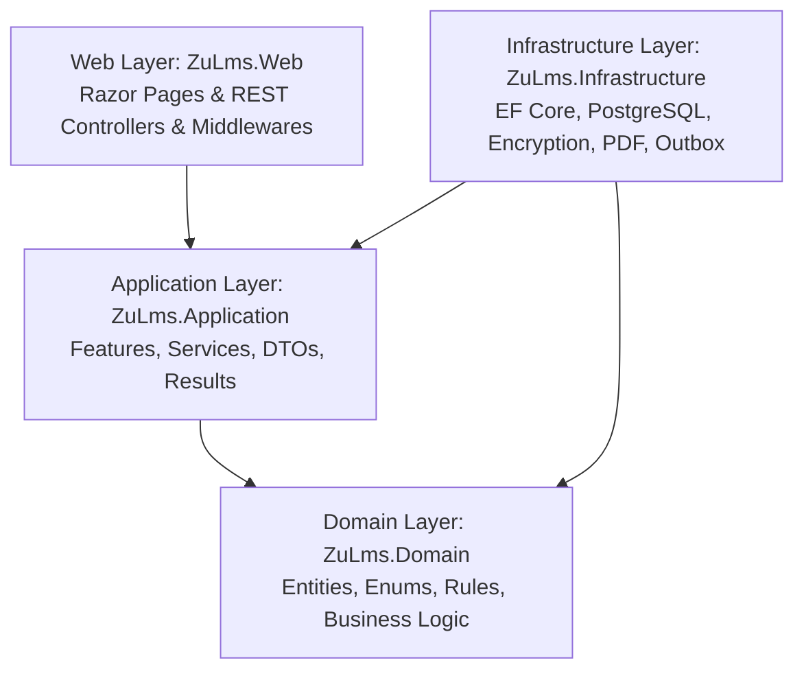
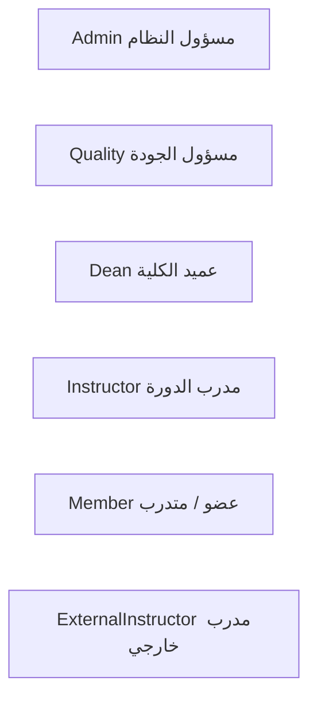
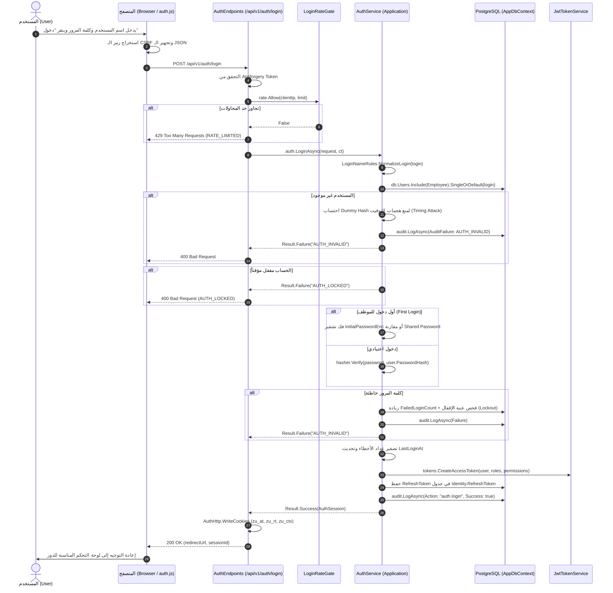
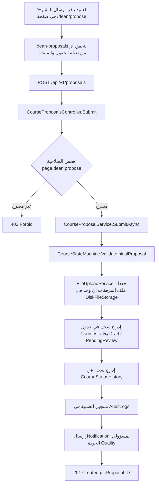
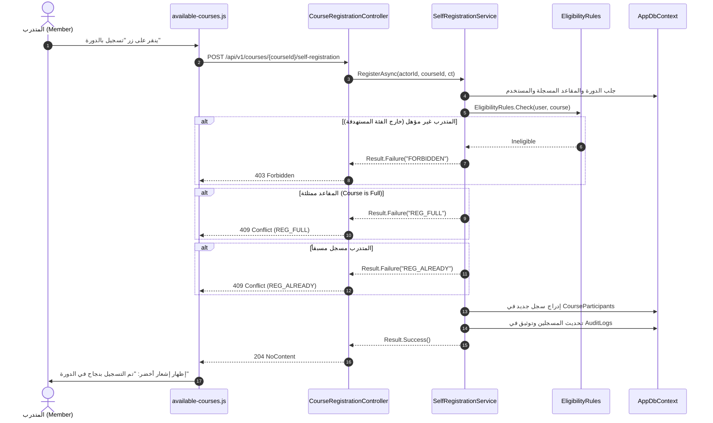

# الدليل الشامل لمعمارية وتدفق العمليات البرمجية في نظام ZU-LMS
## نظام إدارة وتطوير التدريب المهني — جامعة الزرقاء (Zarqa University LMS)

---

## فهرس المحتويات
1. [المقدمة ونظرة عامة على النظام](#1-المقدمة-ونظرة-عامة-على-النظام)
2. [المعمارية التقنية وطبقات النظام (Clean Architecture)](#2-المعمارية-التقنية-وطبقات-النظام-clean-architecture)
3. [الأدوار والمستخدمون في النظام (User Roles & Personas)](#3-الأدوار-والمستخدمون-في-النظام-user-roles--personas)
4. [الآليات العرضية المشتركة (Cross-Cutting Concerns)](#4-الآليات-العرضية-المشتركة-cross-cutting-concerns)
   - [إدارة الجلسات والكوكي وعزل التبويبات (TabSession & Cookies)](#إدارة-الجلسات-والكوكي-وعزل-التبويبات-tabsession--cookies)
   - [حماية الطلبات وأمان الـ CSRF ومعدل الطلبات (Rate Limiting)](#حماية-الطلبات-وأمان-الـ-csrf-ومعدل-الطلبات-rate-limiting)
   - [التشفير وحماية البيانات (AES-GCM & PBKDF2)](#التشفير-وحماية-البيانات-aes-gcm--pbkdf2)
   - [سجل التدقيق الشامل (Comprehensive Audit Logging)](#سجل-التدقيق-الشامل-comprehensive-audit-logging)
5. [التدفق التفصيلي لكل عملية وكبسة في النظام (Button-by-Button Method Flow)](#5-التدفق-التفصيلي-لكل-عملية-وكبسة-في-النظام-button-by-button-method-flow)
   - [5.1 عملية تسجيل الدخول الكاملة (Authentication & Login)](#51-عملية-تسجيل-الدخول-الكاملة-authentication--login)
   - [5.2 التبديل بين أدوار المستخدم (Role Switcher)](#52-التبديل-بين-أدوار-المستخدم-role-switcher)
   - [5.3 تقديم مقترح دورة جديدة بواسطة العميد (Submit Course Proposal)](#53-تقديم-مقترح-دورة-جديدة-بواسطة-العميد-submit-course-proposal)
   - [5.4 مراجعة وقبول/رفض مقترح الدورة بواسطة الجودة (Quality Review Proposal)](#54-مراجعة-وقبولرفض-مقترح-الدورة-بواسطة-الجودة-quality-review-proposal)
   - [5.5 إنشاء دورة تدريبية مباشرة (Direct Course Creation)](#55-إنشاء-دورة-تدريبية-مباشرة-direct-course-creation)
   - [5.6 تصفح الدورات والتسجيل الذاتي للمتدرب (Browse & Self-Register)](#56-تصفح-الدورات-والتسجيل-الذاتي-للمتدرب-browse--self-register)
   - [5.7 إدارة جلسات المحاضرات وإنشاء رمز الحضور / QR (Lectures & Attendance Code)](#57-إدارة-جلسات-المحاضرات-وإنشاء-رمز-الحضور--qr-lectures--attendance-code)
   - [5.8 تسجيل الحضور عبر إدخال الرمز من المتدرب (Enter Attendance Code)](#58-تسجيل-الحضور-عبر-إدخال-الرمز-من-المتدرب-enter-attendance-code)
   - [5.9 الرصد اليدوي للحضور والغياب (Manual Attendance Roster)](#59-الرصد-اليدوي-للحضور-والغياب-manual-attendance-roster)
   - [5.10 إعداد متطلبات الاختبار ورصد النتائج (Exams & Outcomes)](#510-إعداد-متطلبات-الاختبار-ورصد-النتائج-exams--outcomes)
   - [5.11 إنهاء الدورة وإعادة احتساب الأهلية (Finish Course & Recalculate Eligibility)](#511-إنهاء-الدورة-وإعادة-احتساب-الأهلية-finish-course--recalculate-eligibility)
   - [5.12 توليد الشهادات وتصديرها بصيغة PDF (Certificate Generation & Download)](#512-توليد-الشهادات-وتصديرها-بصيغة-pdf-certificate-generation--download)
   - [5.13 التحقق العام من صحة الشهادة عبر الرمز أو QR (Public Certificate Verification)](#513-التحقق-العام-من-صحة-الشهادة-عبر-الرمز-أو-qr-public-certificate-verification)
   - [5.14 إبطال وسحب الشهادة (Revoke Certificate)](#514-إبطال-وسحب-الشهادة-revoke-certificate)
   - [5.15 تعبئة استبانة تقييم الدورة من المتدرب (Submit Course Evaluation)](#515-تعبئة-استبانة-تقييم-الدورة-من-المتدرب-submit-course-evaluation)
   - [5.16 تجميع وتحليل نتائج التقييمات للجودة (Evaluation Aggregation)](#516-تجميع-وتحليل-نتائج-التقييمات-للجودة-evaluation-aggregation)
   - [5.17 تقديم واعتماد إثبات قياس الأثر (Impact Measurement Submission & Review)](#517-تقديم-واعتماد-إثبات-قياس-الأثر-impact-measurement-submission--review)
   - [5.18 تقديم واعتماد الشهادات المهنية الخارجية (External Pro-Certs)](#518-تقديم-واعتماد-الشهادات-المهنية-الخارجية-external-pro-certs)
   - [5.19 رصد ورفع الاحتياجات التدريبية (Training Needs Management)](#519-رصد-ورفع-الاحتياجات-التدريبية-training-needs-management)
   - [5.20 المزامنة الشاملة مع أنظمة الجامعة المركزية (University Data Sync)](#520-المزامنة-الشاملة-مع-أنظمة-الجامعة-المركزية-university-data-sync)
   - [5.21 إدارة المستخدمين والصلاحيات الاستثنائية (Users & Permission Overrides)](#521-إدارة-المستخدمين-والصلاحيات-الاستثنائية-users--permission-overrides)
   - [5.22 إدارة بيانات الاعتماد ومستودع الأمان (Credentials Management & Security Vault)](#522-إدارة-بيانات-الاعتماد-ومستودع-الأمان-credentials-management--security-vault)
6. [الخلاصة](#6-الخلاصة)

---

## 1. المقدمة ونظرة عامة على النظام

مشروع **ZU-LMS** هو منصة متكاملة لإدارة التعليم والتدريب والتطوير المهني مصممة خصيصاً لجامعة الزرقاء. يقوم النظام بأتمتة كافة مراحل الدورات والورش التدريبية لأعضاء الهيئة التدريسية والإدارية والمدربين، بدءاً من حصر الاحتياجات وتقديم مقترحات الدورات، مروراً بإدارتها وتوليد أكواد الحضور بالـ QR، وانتهاءً بالاختبارات، واستطلاعات التقييم، وتوليد الشهادات الموثقة رقمياً بملفات PDF عالية الدقة، مع قياس الأثر التدريبي بعد انقضاء الدورة.

---

## 2. المعمارية التقنية وطبقات النظام (Clean Architecture)

يتبع المشروع معمارية **Clean Architecture (Onion Architecture)** مع فصل صارم بين المسؤوليات:



### 1. طبقة النواة والدومين (`ZuLms.Domain`):
* لا تعتمد على أي مكتبة أو إطار عمل خارجي؛ تحتوي على منطق العمل الصافي (Pure Business Logic).
* **الكيانات (`Entities`):** مثل `Course`, `User`, `Lecture`, `AttendanceRecord`, `Certificate`, `EvaluationResponse`, `TrainingNeed`, `ProfessionalCert`.
* **قواعد العمل المستقلة (`Rules`):** 
  - `AttendanceRules`: معادلات احتساب نسب الحضور والغياب وعتبات التأهيل.
  - `CourseStateMachine`: آلة الحالة لتحولات الدورة التدريبية ومحددات الانتقال المسموحة.
  - `EligibilityRules`: التحقق التلقائي من استحقاق المتدرب للتسجيل أو الحصول على الشهادة.
  - `CertificateReference`: خوارزمية توليد الرقم المرجعي الفريد لكل شهادة.
  - `PasswordPolicyRules` و `PasswordRotationRules`: سياسات أمان كلمات المرور وتعقيدها وفترة تدويرها.

### 2. طبقة التطبيق (`ZuLms.Application`):
* تنسيق تدفق البيانات وحالات الاستخدام (Use Cases).
* واجهات الخدمات (`Interfaces`): مثل `IAuthService`, `ICourseProposalService`, `ILectureService`, `ICertificateService`, `IUniversitySyncService`.
* نمط النتيجة (`Result<T>` Pattern): الاستغناء عن رمي الـ Exceptions لأخطاء العمل وتغليف الاستجابة بكائنات `Result.Success` أو `Result.Failure(code)`.

### 3. طبقة البنية التحتية (`ZuLms.Infrastructure`):
* **قاعدة البيانات:** PostgreSQL 17 عبر Entity Framework Core وسياق `AppDbContext`.
* **الأمان والتشفير:** 
  - خوارزمية `AesGcmEncryptionService` (AES-256-GCM) لتشفير البيانات الحساسة وكلمات المرور الأولية.
  - خوارزمية `Pbkdf2PasswordHasher` (PBKDF2 مع SHA256 و 600,000 دورة) لتجزئة كلمات المرور.
  - خدمة توليد وفحص الـ JWT عبر `JwtTokenService`.
* **الطباعة والمستندات:** توليد ملفات PDF العربية المعقدة للشهادات باستخدام مكتبة `QuestPDF` مع خط `Tajawal`.
* **العمال في الخلفية (Background Workers):** مثل `EmailOutboxWorker` لمعالجة طابور البريد الإلكتروني.

### 4. طبقة العرض والواجهة (`ZuLms.Web`):
* تعتمد واجهات هجينة: **Razor Pages** للعرض السريع مع **Vanilla JavaScript** وواجهات برمجة التطبيقات **RESTful APIs** (`/api/v1/...`).
* **Middlewares مخصصة:** 
  - `ApiEnvelopeMiddleware`: لتوحيد مخرجات الـ API بنسق قياسي.
  - `CorrelationIdMiddleware`: لتتبع كل طلب برقم فريد عبر جميع السجلات (Logs).
  - حماية CSRF على كافة طلبات التعديل.

---

## 3. الأدوار والمستخدمون في النظام (User Roles & Personas)

يحتوي النظام على 6 أدوار رئيسية (`RoleCode`):



1. **مسؤول النظام (`Admin`):** إدارة الحسابات، الصلاحيات الاستثنائية، المزامنة المركزية، مستودع الأمان (Vault)، ومراقبة الأحداث الحية.
2. **مسؤول الجودة والاعتماد (`Quality`):** اعتماد أو رفض مقترحات الدورات، إدارة المسارات التدريبية، اعتماد الشهادات المهنية، تحليل استبانات التقييم، ومراجعة قياس الأثر الموجه للجودة.
3. **عميد الكلية (`Dean`):** تقديم مقترحات الدورات لكليته، تحديد الاحتياجات التدريبية للقسم، متابعة كادر الكلية التدريسي، ومراجعة قياس أثر دورة العميد التي بقيت مخصصة لكليته.
4. **مدرب الدورة (`Instructor`):** تنظيم جلسات المحاضرات، إنشاء أكواد الحضور بالـ QR، رصد الحضور اليدوي، وإدخال علامات الاختبارات. لا يراجع قياس الأثر.
5. **المتدرب / عضو هيئة التدريس (`Member`):** التسجيل الذاتي بالدورات، مسح رمز الحضور للمحاضرات، تقديم التقييمات، تنزيل الشهادات، ورفع الشهادات المهنية الخارجية.
6. **المدرب الخارجي (`ExternalInstructor`):** محاضر من خارج كادر الجامعة يمتلك صلاحيات إدارة المحاضرات والحضور الخاصة بدورته فقط.

---

## 4. الآليات العرضية المشتركة (Cross-Cutting Concerns)

### إدارة الجلسات والكوكي وعزل التبويبات (TabSession & Cookies)
* النظام لا يعتمد على تخزين الـ JWT في الـ LocalStorage منعاً لهجمات XSS، بل يستخدم **HTTP-Only, Secure, SameSite=Lax Cookies**:
  - `zu_at`: يحمل رمز الدخول الصغير (Access Token).
  - `zu_rt`: يحمل رمز التجديد (Refresh Token) المرتبط بقاعدة البيانات.
  - `zu_ctx`: يحمل سياق الدور الحالي والكلية.
* **عزل التبويبات (`TabSession`):** يضمن النظام أن فتح عدة تبويبات للمستخدم بأدوار مختلفة لا يؤدي إلى تعارض الصلاحيات، حيث يتم تخصيص معرّف تبويب فريد لكل نافذة متصفح.

### حماية الطلبات وأمان الـ CSRF ومعدل الطلبات (Rate Limiting)
* كل طلب `POST` / `PUT` / `DELETE` إلى الـ API يمر عبر `ApiAntiforgeryAttribute` للتحقق من هيدر `RequestVerificationToken`.
* عمليات تسجيل الدخول تخضع لخدمة `LoginRateGate` التي تحظر محاولات التخمين بتحديد عدد الطلبات القصوى لكل عنوان IP بالدقيقة (`auth.login_max_per_ip_minute`).

### التشفير وحماية البيانات (AES-GCM & PBKDF2)
* كلمات المرور تُخزّن عبر `Pbkdf2PasswordHasher` بملح (Salt) عشوائي 16 بايت وتشفير 32 بايت، مع التحقق المستمر من الحاجة لإعادة التجزئة (`NeedsRehash`).
* كلمات المرور الأولية المنشأة للموظفين عند المزامنة يتم تشفيرها باستخدام مفاتيح `ZU_ENC_KEYS` بخوارزمية متطورة `AES-256-GCM` قابلة للاسترجاع من قبل الآدمن في شاشة الـ Vault فقط.

### سجل التدقيق الشامل (Comprehensive Audit Logging)
* أي عملية حساسة (دخول، تغيير كلمة سر، تعديل درجات، إلغاء دورة، سحب شهادة) يتم توثيقها تلقائياً عبر `IAuditLogger` في جدول `AuditLog`، متضمنة: المعرف، المستخدم الفاعل، عنوان الـ IP، وقت الحدوث بالتوقيت العالمي، والكيان المتأثر قبل وبعد الإجراء.

---

## 5. التدفق التفصيلي لكل عملية وكبسة في النظام (Button-by-Button Method Flow)

سنستعرض الآن كل كبسة وعملية في النظام من لحظة نقر المستخدم في المتصفح وحتى وصولها لقاعدة البيانات وعودتها للمستخدم.

---

### 5.1 عملية تسجيل الدخول الكاملة (Authentication & Login)



* **الواجهة:** صفحة `Areas/Public/Pages/Login.cshtml` وملف `wwwroot/js/auth.js`.
* **الكبسة:** زر `#login-button` ("تسجيل الدخول").
* **مسار الـ HTTP:** `POST /api/v1/auth/login`.
* **ميثود الويب:** الدالة المعرفة داخل [`AuthEndpoints.cs`](file:///c:/Users/VIP/Documents/ChatGPT/New%20project/newnew/zu-lms/src/ZuLms.Web/Security/AuthEndpoints.cs).
* **ميثود الخدمة:** `AuthService.LoginAsync(LoginRequest request, CancellationToken ct)`.
* **قواعد الدومين المتأثرة:** 
  - `LoginNameRules.NormalizeLogin`: تنظيف وتوحيد مدخلات اسم الدخول.
  - `PasswordRotationRules.IsDue`: فحص هل حان موعد التغيير الدوري لكلمة المرور.
* **الجداول المتأثرة في قاعدة البيانات:** `Users` (تحديث `LastLoginAt` و `FailedLoginCount`)، `RefreshTokens` (إدراج الرمز الجديد)، و `AuditLogs` (تسجيل محاولة الدخول).

---

### 5.2 التبديل بين أدوار المستخدم (Role Switcher)

عندما يمتلك المستخدم أكثر من دور (مثلاً: أستاذ جامعي `Instructor` وفي نفس الوقت عميد `Dean` أو منسق `Quality`):
* **الواجهة:** القائمة المنسدلة للأدوار في الهيدر العلوي `_RoleSwitcher.cshtml` وملف `wwwroot/js/role-switcher.js`.
* **الكبسة:** اختيار الدور المطلوب من القائمة والنقر لتفعيله.
* **مسار الـ HTTP:** `POST /api/v1/auth/context/switch-role`.
* **ميثود الويب:** داخل `ContextEndpoints.cs`.
* **ميثود الخدمة:** `UserStateCache.SwitchActiveRoleAsync(userId, newRole)`.
* **التدفق البرمجي:**
  1. التحقق من أن الدور المطلوب ينتمي فعلياً إلى قائمة أدوار المستخدم المسجلة في `UserRoles`.
  2. إعادة إصدار كوكي السياق `zu_ctx` متضمناً `ActiveRole = newRole`.
  3. استدعاء `audit.LogAsync` لتوثيق تبديل الدور في `AuditLogs`.
  4. إعادة توجيه المتصفح إلى لوحة التحكم الخاصة بالدور المختار (مثلاً `/dean/dashboard` أو `/instructor/courses`).

---

### 5.3 تقديم مقترح دورة جديدة بواسطة العميد (Submit Course Proposal)



* **الواجهة:** صفحة `Pages/Dean/Propose.cshtml` وملف `wwwroot/js/dean-proposals.js`.
* **الكبسة:** زر `#btn-submit-proposal` ("إرسال مقترح الدورة").
* **الطلب:** `POST /api/v1/proposals` مع Payload يحتوي على: العنوان بالعربية والإنجليزية، الأهداف، الفئة المستهدفة، عدد الساعات، الكلية المقترحة، واسم المحاضر.
* **ميثود الويب:** `CourseProposalsController.Submit`.
* **ميثود الخدمة:** `CourseProposalService.SubmitAsync(actorId, input, ct)`.
* **الجداول المتأثرة:** `Courses`, `CourseProposals`, `CourseStatusHistorys`, `Notifications`, `AuditLogs`.

---

### 5.4 مراجعة وقبول/رفض مقترح الدورة بواسطة الجودة (Quality Review Proposal)

* **الواجهة:** صفحة `Pages/Quality/Proposals.cshtml` وملف `wwwroot/js/quality-proposals.js`.
* **الكبسة:** زر "اعتماد المقترح" (Approve) أو "طلب تعديل" (Request Revision) أو "رفض" (Reject).
* **مسار الـ HTTP:** `PUT /api/v1/proposals/{id}/decision`.
* **ميثود الويب:** `CourseProposalsController.Decide`.
* **ميثود الخدمة:** `CourseProposalService.DecideAsync(actorId, proposalId, decision, notes, ct)`.
* **التدفق وقواعد الأعمال:**
  1. التحقق من صلاحية `proposal.review`.
  2. فحص حالة المقترح الحالية عبر `CourseStateMachine`: يجب أن يكون في حالة `PendingReview`.
  3. في حالة **الاعتماد (`Approve`)**:
     - تتحول حالة الدورة إلى `Approved`.
     - يتم ربط الدورة بالمسار التدريبي (`Track`) المحدد.
     - إنشاء إشعار لعميد الكلية بأن مقترحه تم اعتماده.
  4. في حالة **طلب التعديل (`Revise`)**:
     - تتحول الحالة إلى `RequiresRevision` مع تدوين الملاحظات.
  5. حفظ التغييرات وتوثيق الحدث في `CourseStatusHistorys` و `AuditLogs`.

---

### 5.5 إنشاء دورة تدريبية مباشرة (Direct Course Creation)

يقوم مسؤول النظام أو الجودة بإنشاء دورة تدريبية مباشرة دون المرور بدورة المقترحات:
* **الواجهة:** صفحة `Pages/Admin/CoursesNew.cshtml` أو `Pages/Quality/CoursesNew.cshtml` وملف `direct-course.js`.
* **الكبسة:** زر "إنشاء ونشر الدورة التدريبية".
* **مسار الـ HTTP:** `POST /api/v1/courses/direct`.
* **ميثود الويب:** `DirectCoursesController.Create`.
* **ميثود الخدمة:** `DirectCourseService.CreateAsync(actorId, input, ct)`.
* **التدفق الداخلي:**
  1. التحقق من صلاحية `course.create_direct`.
  2. فحص أوقات البداية والنهاية والقاعة والمحاضر الداخلي أو الخارجي.
  3. تطبيق `CourseStateMachine.CreateDirect`: إنشاء الدورة مباشرة بحالة `Scheduled` أو `RegistrationOpen`.
  4. إنشاء مجلد التخزين الخاص بالدورة في `DiskFileStorage`.
  5. إدراج السجل في جدول `Courses` وإطلاق إشعار للمحاضر المكلف.

---

### 5.6 تصفح الدورات والتسجيل الذاتي للمتدرب (Browse & Self-Register)



* **الواجهة:** صفحة `Pages/Courses/Available.cshtml` وملف `wwwroot/js/available-courses.js`.
* **الكبسة:** زر `.btn-register` ("تسجيل في الدورة").
* **مسار الـ HTTP:** `POST /api/v1/courses/{courseId}/self-registration`.
* **ميثود الويب:** `CourseRegistrationController.Register(long courseId, CancellationToken ct)`.
* **ميثود الخدمة:** `SelfRegistrationService.RegisterAsync(actorId, courseId, ct)`.
* **الجداول المتأثرة:** `CourseParticipants`, `Courses`, `AuditLogs`.

---

### 5.7 إدارة جلسات المحاضرات وإنشاء رمز الحضور / QR (Lectures & Attendance Code)

يقوم المحاضر داخل قاعة التدريب بتوليد كود ديناميكي أو رمز QR للمتدربين:
* **الواجهة:** صفحة `Pages/Instructor/Lectures.cshtml` وملف `wwwroot/js/course-lectures.js`.
* **الكبسة:** زر "تفعيل رمز التحضير" (Generate/Activate Attendance Code).
* **مسار الـ HTTP:** `POST /api/v1/lectures/{id}/activate-code`.
* **ميثود الويب:** `LectureCodeController.Activate(long id, CancellationToken ct)`.
* **ميثود الخدمة:** `LectureService.ActivateCodeAsync(actorId, lectureId, ct)`.
* **التدفق وقواعد الأعمال:**
  1. التحقق من صلاحية `attendance.activate_code` وأن المحاضر هو المسؤول الفعلي عن الدورة.
  2. توليد كود عشوائي فريد مكون من 6 أحرف/أرقام عبر مولد كريبتوغرافي آمن.
  3. تعيين مدة صلاحية الكود (مثلاً 10 دقائق من لحظة التوليد) وتخزين `AttendanceCodeExpiresAt`.
  4. استدعاء `QrCodeService.GenerateSvg` لإنشاء صورة رمز استجابة سريعة (QR Code) لعرضها على شاشة العرض بالقاعة.
  5. حفظ الكود في جدول `Lectures` وإرجاعه للواجهة ليعرض على الشاشة الكبيرة.

---

### 5.8 تسجيل الحضور عبر إدخال الرمز من المتدرب (Enter Attendance Code)

* **الواجهة:** صفحة `Pages/Member/EnterCode.cshtml` أو مسح الـ QR بكاميرا الهاتف المحمول، وملف `wwwroot/js/member-enter-code.js`.
* **الكبسة:** زر "تأكيد الحضور".
* **مسار الـ HTTP:** `POST /api/v1/lectures/{id}/attendance/enter-code`.
* **ميثود الويب:** `AttendanceCodeController.Enter(long id, EnterCodeRequest request, CancellationToken ct)`.
* **ميثود الخدمة:** `AttendanceCodeService.EnterAsync(actorId, lectureId, code, ct)`.
* **قواعد التحقق الصارمة (`AttendanceRules`):**
  1. هل المتدرب مسجل رسمياً ونشط في هذه الدورة؟
  2. هل كود المحاضرة لا يزال ساري المفعول (`now <= lecture.AttendanceCodeExpiresAt`)؟
  3. هل الكود المدخل يطابق الكود المولد تماماً؟
  4. هل تم رصد حضور هذا المتدرب مسبقاً في هذه الجلسة لمنع التكرار؟
  5. تسجيل محاولة التحضير الفاشلة في `AttendanceCodeAttempts` للحد من التخمين العشوائي.
* **الجداول المتأثرة:** `AttendanceRecords` (إدراج سجل حضور بنوع `Source = AttendanceSource.SelfCode`)، `AttendanceCodeAttempts`، و `AuditLogs`.

---

### 5.9 الرصد اليدوي للحضور والغياب (Manual Attendance Roster)

في حال واجه متدرب مشكلة تقنية أو أراد المحاضر تعديل حالة متدرب يدوياً:
* **الواجهة:** صفحة كشف الحضور والغياب للمحاضرة `course-lectures.js`.
* **الكبسة:** زر التبديل (حاضر / غائب / معذور) والنقر على "حفظ الحالة".
* **مسار الـ HTTP:** `PUT /api/v1/lectures/{id}/attendance/roster/{participantId}`.
* **ميثود الويب:** `ManualAttendanceController.Set`.
* **ميثود الخدمة:** `ManualAttendanceService.SetAsync(actorId, lectureId, participantId, isPresent, reason, ct)`.
* **التدفق:**
  1. التحقق من صلاحية `attendance.edit_manual`.
  2. تحديث سجل الحضور في `AttendanceRecords` مع وسم المصدر بـ `AttendanceSource.ManualOverride`.
  3. تسجيل التغيير مع السبب في جدول `AttendanceChanges` لضمان الشفافية وقابلية التدقيق الأكاديمي.

---

### 5.10 إعداد متطلبات الاختبار ورصد النتائج (Exams & Outcomes)

* **الواجهة:** تبويب الاختبارات داخل صفحة المحاضر وملف `instructor-progress.js`.
* **الكبسة:** زر "حفظ نتيجة الاختبار" لكل متدرب (ناجح Pass / راسب Fail).
* **مسار الـ HTTP:** `PUT /api/v1/courses/{courseId}/exam/participants/{participantId}`.
* **ميثود الويب:** `ExamsController.Record`.
* **ميثود الخدمة:** `ExamService.RecordAsync(actorId, courseId, participantId, outcome, ct)`.
* **التدفق وقواعد الأعمال:**
  1. التحقق من وجود اختبار معد للدورة (`CourseExam`).
  2. تسجيل النتيجة في جدول `ExamResults`.
  3. توثيق تاريخ التعديل في `ExamResultHistorys`.
  4. استدعاء فوري لمحرك الأهلية لمعرفة هل أصبح المتدرب مستحقاً لشهادة الإتمام.

---

### 5.11 إنهاء الدورة وإعادة احتساب الأهلية (Finish Course & Recalculate Eligibility)

تعد هذه الكبسة من أهم وأخطر العمليات المركزية في النظام حيث تنقل الدورة من التنفيذ إلى الأرشفة وتستعد لإصدار الشهادات:

```mermaid
flowchart TD
    Click[المحاضر أو الآدمن ينقر 'إنهاء الدورة' Finish Course] --> Req[POST /api/v1/courses/{id}/finish]
    Req --> Ctrl[CourseFinishController.Post]
    Ctrl --> Perm{فحص الصلاحية:\ncourse.finish}
    Perm -- غير مصرح --> 403[403 Forbid]
    Perm -- مصرح --> Svc[CourseFinishService.FinishAsync]
    Svc --> Lock[بدء Serializable Transaction وحجز القفل]
    Lock --> MinLec{فحص عدد المحاضرات المكتملة:\nlecturesCount >= min}
    MinLec -- غير مكتملة --> ErrNoLec[400 FINISH_NO_LECTURES]
    MinLec -- مكتملة --> UpdateCourse[تحديث Course: Status = Finished\nFinalLecturesCount = lecturesCount]
    UpdateCourse --> Recalc[استدعاء EligibilityRecalculationService]
    Recalc --> CalcLoop[حلقة تكرار على جميع المشاركين:\nاحتساب نسبة الحضور الفعلي\nفحص علامة الاختبار]
    CalcLoop --> Qualify[تحديد المتدربين المستحقين للشهادة Eligible]
    Qualify --> StatusHist[تسجيل CourseStatusHistory]
    StatusHist --> NotifyAll[إدراج إشعارات لكافة المتدربين: NotificationType.CourseFinished]
    NotifyAll --> Audit[تسجيل العملية في AuditLogs]
    Audit --> Commit[تأكيد العملية Commit Transaction]
    Commit --> Res[200 OK مع finalLecturesCount]
```

* **الواجهة:** صفحة تفاصيل الدورة للمحاضر والآدمن `course-details.js`.
* **الكبسة:** زر `#btn-finish-course` ("إنهاء الدورة التدريبية واعتماد النتائج").
* **مسار الـ HTTP:** `POST /api/v1/courses/{courseId}/finish`.
* **ميثود الويب:** `CourseFinishController.Post`.
* **ميثود الخدمة:** `CourseFinishService.FinishAsync(actorId, courseId, ct)`.
* **الخدمة المساعدة:** `EligibilityRecalculationService.RecalculateCourseAsync(...)`.
* **الجداول المتأثرة:** `Courses`, `CourseParticipants`, `CourseStatusHistorys`, `Notifications`, `AuditLogs`.

---

### 5.12 توليد الشهادات وتصديرها بصيغة PDF (Certificate Generation & Download)

بعد انتهاء الدورة واستحقاق المتدربين، يتم توليد الشهادات المعتمدة:
* **الواجهة:** زر "إصدار الشهادات المعلقة" من قبل الآدمن/الجودة، أو زر "تحميل الشهادة" من شاشة المتدرب `Pages/Member/Certificates.cshtml`.
* **مسار الـ HTTP:** 
  - للإصدار: `POST /api/v1/certificates/issue-pending?courseId=...`.
  - للتحميل: `GET /api/v1/certificates/{id}/pdf`.
* **ميثود الويب:** `CertificatesController.IssuePending` و `CertificatesController.Pdf`.
* **ميثود الخدمة:** `CertificateService.IssuePendingAsync` و `CertificateService.GetPdfAsync`.
* **محرك توليد الـ PDF الداخلي (`QuestPdfCertificateRenderer`):**
  1. استرجاع بيانات الشهادة، الدورة، المتدرب، الكلية، وتاريخ الإتمام.
  2. إنشاء الرقم المرجعي الفريد للشهادة عبر `CertificateReference.Generate` (مثل: `ZU-LMS-2026-XXXX`).
  3. توليد رمز التحقق الرقمي ورسم QR كود يقود مباشرة إلى صفحة التحقق الإلكترونية للجامعة (`https://portal.zu.edu.jo/verify?code=...`).
  4. تحميل الخطوط العربية المضمنة (`Tajawal-Bold`, `Tajawal-Regular`).
  5. دمج قالب الشهادة الرسمي المعتمد من جامعة الزرقاء (الخلفية، الشعارات، التواقيع).
  6. تصيير ملف الـ PDF كبيانات بايت ثنائية مشفرة وتخزينها في جدول `Files` وعبر `DiskFileStorage`.
  7. إرجاع الملف بـ `MimeType: application/pdf` وهيدر `Content-Disposition: attachment`.

---

### 5.13 التحقق العام من صحة الشهادة عبر الرمز أو QR (Public Certificate Verification)

صفحة عامة متاحة لأي جهة توظيف أو شخص للتحقق من صحة أي شهادة صادرة:
* **الواجهة:** صفحة `Areas/Public/Pages/Verify.cshtml` وملف `wwwroot/js/verify.js`.
* **الكبسة:** إدخال الرقم المرجعي للشهادة والنقر على "تحقق من الشهادة"، أو مسح الـ QR تلقائياً عبر الهاتف.
* **مسار الـ HTTP:** `GET /api/v1/public/verify?code={referenceNumber}`.
* **ميثود الويب:** داخل `VerifyEndpoints.cs`.
* **ميثود الخدمة:** `CertificateService.VerifyPublicAsync(code, ct)`.
* **النتيجة والبيانات المعروضة:**
  - في حال كانت صحيحة ونشطة: تظهر علامة الصح الخضراء، اسم المتدرب الثلاثي، اسم الدورة، عدد الساعات التدريبية، تاريخ الإصدار، واسم المحاضر.
  - في حال كانت ملغاة: تظهر شارة حمراء تحذيرية "هذه الشهادة تم إبطالها رسمياً" مع تاريخ الإبطال.
  - في حال عدم وجودها: "الشهادة غير مطابقة لسجلات جامعة الزرقاء".

---

### 5.14 إبطال وسحب الشهادة (Revoke Certificate)

* **الواجهة:** صفحة شهادات الجودة والآدمن `quality-certificates.js`.
* **الكبسة:** زر "إبطال الشهادة" (Revoke) مع إدخال سبب الإلغاء في نافذة منبثقة.
* **مسار الـ HTTP:** `POST /api/v1/certificates/{id}/revoke`.
* **ميثود الويب:** `CertificatesController.Revoke`.
* **ميثود الخدمة:** `CertificateService.RevokeAsync(actorId, id, reason, ct)`.
* **التدفق:**
  1. التحقق من صلاحية `certificates.revoke_manual`.
  2. تغيير حالة الشهادة في جدول `Certificates` إلى `CertificateStatus.Revoked`.
  3. تسجيل تاريخ الإلغاء، هوية القائم بالإلغاء، وسبب الإلغاء.
  4. تسجيل الإجراء كحدث أمني فائق الأهمية في `AuditLogs`.
  5. إرسال إشعار فوري للمتدرب بإبطال شهادته والسبب.

---

### 5.15 تعبئة استبانة تقييم الدورة من المتدرب (Submit Course Evaluation)

* **الواجهة:** صفحة تفاصيل الدورة بعد انتهائها `course-details.js`.
* **الكبسة:** زر "إرسال التقييم" بعد الإجابة على محاور استبانة الجودة.
* **مسار الـ HTTP:** `POST /api/v1/courses/{courseId}/evaluation`.
* **ميثود الويب:** `EvaluationsController.Submit`.
* **ميثود الخدمة:** `EvaluationService.SubmitAsync(actorId, courseId, answers, ct)`.
* **قواعد العمل:**
  1. فحص فترة التقييم المسموحة (`EvaluationPeriod`).
  2. التأكد من أن المتدرب أتم الحضور ولم يسبق له تقييم هذه الدورة (استبانة سرية مجهولة الهوية Anonymous لحماية الشفافية مع تسجيل إتمام التقييم للمستخدم لمنع التكرار).
  3. حفظ الإجابات في جدول `EvaluationResponses`.

---

### 5.16 تجميع وتحليل نتائج التقييمات للجودة (Evaluation Aggregation)

* **الواجهة:** صفحة `Pages/Quality/Evaluations.cshtml` وملف `quality-eval-results.js`.
* **الكبسة:** اختيار الدورة أو الكلية وتحديد خيارات الفلترة لعرض التقرير التحليلي.
* **مسار الـ HTTP:** `GET /api/v1/evaluation/results/{courseId}`.
* **ميثود الويب:** `EvaluationResultsController.Results`.
* **ميثود الخدمة:** `EvaluationQueryService.CourseResultsAsync(actorId, courseId, ct)`.
* **المعالجة الحسابية:**
  - احتساب المتوسطات الحسابية والانحراف المعياري لكل سؤال ولمحاور التقييم (المادة التدريبية، أداء المحاضر، القاعة والبيئة، التفاعل).
  - إرجاع البيانات لدعم الرسوم البيانية والجداول الإحصائية.

---

### 5.17 تقديم واعتماد إثبات قياس الأثر (Impact Measurement Submission & Review)

* **علاقته بالاستحقاق:** قياس الأثر اختياري ولا يدخل في معادلة استحقاق الدورة أو إصدار الشهادة. عدم الرفع، أو بقاء الطلب قيد المراجعة، أو إعادته للتعديل لا يمنع الشهادة.
* **الواجهة:** صفحة `Pages/Member/Impact.cshtml` للمتدرب، وصفحة المراجعة المشتركة `Pages/Instructor/Impact.cshtml` على المسار `/impact/review` للجودة والعميد والأدمن. اسم الملف موروث تقنياً ولا يمنح المحاضر صلاحية الوصول.
* **الكبسة للمتدرب:** رفع ملف التطبيق العملي ونقر زر "إرسال إثبات تطبيق المعرفة".
* **مسار الـ HTTP:** `POST /api/v1/courses/{courseId}/impact`.
* **ميثود الويب:** `ImpactsController.Submit`.
* **ميثود الخدمة:** `ImpactService.SubmitAsync(actorId, courseId, type, fileId, ct)`.
* **قواعد الوجهة:** يوجه الطلب إلى العميد فقط إذا كانت الدورة `DeanProposal` ومخصصة لنفس كلية الاقتراح (`Faculty` و`TargetCenterId == ProposingCenterId`) ولم تكن `ManagedByQuality`. العامة والإدارية والمخصصة لأسماء والمحولة لكلية أخرى ودورات الجودة وكل الحالات الأخرى توجه للجودة. الأدمن يرى جميع الطلبات في المسارين.
* **عرض دورات المراجعة:** `GET /api/v1/impact/review-courses` عبر `ImpactService.ReviewCoursesAsync(...)`، مع تطبيق نطاق الجهة والكلية قبل إظهار الدورة.
* **كبسة المراجعة للجودة/العميد/الأدمن:** زر "اعتماد" أو "إعادة للتعديل"؛ الإعادة تتطلب ملاحظات وتسمح للمتدرب برفع نسخة مصححة. المحاضر الداخلي والخارجي لا يستطيعان العرض أو المراجعة أو تنزيل ملف قياس الأثر بصفة مراجع.
* **مسار مراجعة الـ HTTP:** `POST /api/v1/courses/{courseId}/impact/{submissionId}/review`.
* **ميثود الخدمة:** `ImpactService.ReviewAsync(...)`.
* **الإشعارات:** عند الرفع يخطر النظام جهة المراجعة المحددة وجميع الأدمن، ولا يخطر المحاضر. قرار الاعتماد أو الإعادة يرسل إلى المتدرب.

---

### 5.18 تقديم واعتماد الشهادات المهنية الخارجية (External Pro-Certs)

* **الواجهة:** صفحة `Pages/Member/ProCerts.cshtml` وملف `member-pro-certs.js`.
* **الكبسة:** زر "تقديم شهادة مهنية جديدة" مع رفع ملف الشهادة وإدخال الجهة المانحة وتاريخ الانتهاء.
* **مسار الـ HTTP:** `POST /api/v1/procerts`.
* **ميثود الويب:** `ProCertsController.Create`.
* **ميثود الخدمة:** `ProCertService.CreateAsync(actorId, input, ct)`.
* **كبسة اعتماد الجودة:** زر "اعتماد واحتساب النقاط" في `Pages/Quality/ProCerts.cshtml` -> `POST /api/v1/procerts/{id}/review`.
* **الجداول المتأثرة:** `ProfessionalCerts`, `ProfessionalCertEvents`, `AuditLogs`.

---

### 5.19 رصد ورفع الاحتياجات التدريبية (Training Needs Management)

* **الواجهة:** صفحة `Pages/Dean/Needs.cshtml` لعمداء الكليات.
* **الكبسة:** زر "إرسال حاجة تدريبية للقسم".
* **مسار الـ HTTP:** `POST /api/v1/needs`.
* **ميثود الويب:** `NeedsController.Create`.
* **ميثود الخدمة:** `NeedService.CreateAsync(actorId, input, ct)`.
* **شاشة المراجعة:** يستعرضها مسؤول الجودة والآدمن في `/quality/needs` و `/admin/needs` لتجميع الاحتياجات وصياغة الخطة التدريبية السنوية للجامعة.

---

### 5.20 المزامنة الشاملة مع أنظمة الجامعة المركزية (University Data Sync)

تقوم هذه العملية بمزامنة بيانات الموظفين والكليات والمراكز من قواعد بيانات الجامعة المركزية:
* **الواجهة:** صفحة `Pages/Admin/Sync.cshtml` وملف `university-sync.js`.
* **الكبسة:** زر "بدء المزامنة الفورية" (Trigger Full Sync Now).
* **مسار الـ HTTP:** `POST /api/v1/sync/runs`.
* **ميثود الويب:** `SyncController.Start`.
* **ميثود الخدمة:** `UniversitySyncCoordinator.StartAsync(actorId, ct)`.
* **التدفق العميق والتعامل مع التزامن (Concurrency & Locks):**
  1. التحقق من صلاحية `sync.run`.
  2. استخدام قفل الذاكرة `UniversitySyncLock` لمنع تشغيل عمليتي مزامنة في نفس اللحظة.
  3. استدعاء `UniversityApiClient` لسحب بيانات الكليات والأقسام والموظفين عبر بروتوكول مشفر.
  4. استدعاء `UniversityMergeService` للمقارنة واكتشاف السجلات الجديدة والمحدثة والمستقيلة.
  5. استدعاء `UniversityProvisioningService` لإنشاء الحسابات المحلية الجديدة للموظفين وتوليد كلمات مرورهم الأولية وتشفيرها فورياً بـ AES-256-GCM.
  6. تسجيل تقرير شامل للعملية في `SyncRuns` و `SyncReviews` لتمكين الآدمن من مراجعة أي تعارضات بيانات وحلها.

---

### 5.21 إدارة المستخدمين والصلاحيات الاستثنائية (Users & Permission Overrides)

* **الواجهة:** صفحة `Pages/Admin/Users.cshtml` وملف `admin-dashboard.js`.
* **الكبسة:** زر "تخصيص صلاحيات استثنائية للمستخدم" (Grant/Deny Specific Permission).
* **مسار الـ HTTP:** `PUT /api/v1/users/{id}/permissions`.
* **ميثود الويب:** `UsersController.UpdatePermissions`.
* **ميثود الخدمة:** `UserService.SetPermissionOverrideAsync(actorId, targetUserId, permKey, allow, ct)`.
* **التدفق:**
  1. إدراج أو تحديث سجل في جدول `UserPermissionOverrides`.
  2. إبطال الـ Cache المخزن في `UserStateCache` لهذا المستخدم فورياً، بحيث تنعكس صلاحياته الجديدة في اللحظة نفسها دون الحاجة لتسجيل خروجه.
  3. توثيق التعديل الحساس في `AuditLogs`.

---

### 5.22 إدارة بيانات الاعتماد ومستودع الأمان (Credentials Management & Security Vault)

شاشة أمنية خاصة بمسؤول النظام لاسترجاع أو إعادة إرسال بيانات الدخول الأولية للموظفين:
* **الواجهة:** صفحة `Pages/Vault/Index.cshtml` وصفحة `Pages/Admin/Credentials.cshtml` وملف `vault.js`.
* **الكبسة:** زر "كشف كلمة المرور الأولية" (Reveal Initial Password).
* **مسار الـ HTTP:** `POST /api/v1/vault/reveal/{userId}`.
* **ميثود الويب:** `VaultController.Reveal`.
* **ميثود الخدمة:** `VaultService.RevealCredentialsAsync(actorId, targetUserId, masterPassword, ct)`.
* **الإجراءات الأمنية القصوى:**
  1. طلب إعادة إدخال كلمة سر الآدمن الحالية والتأكد منها (`Reauthentication Cache`).
  2. فك تشفير حقل `InitialPasswordEnc` عبر `AesGcmEncryptionService`.
  3. تسجيل محاولة الكشف في جدول التدقيق الأمني `AuditLogs` متضمنة رقم هوية الآدمن والمستخدم المستهدف.
  4. إرجاع كلمة المرور للواجهة لعرضها مؤقتاً لعدة ثوانٍ فقط.

---

## 6. الخلاصة

يتميز نظام **ZU-LMS** بمعمارية رصينة للغاية توازن بين:
1. **الأمان العالي:** تشفير AES-GCM، تجزئة PBKDF2، حماية ضد هجمات CSRF و Timing Attacks و Brute-Force Rate Limiting، وعزل التبويبات عبر TabSession.
2. **الشفافية والتدقيق:** تسجيل كل حركة ونقرة في جدول `AuditLogs` وإتاحة مراقبة الأحداث عبر بث حي `LiveFeed`.
3. **التكامل والأتمتة:** توليد مستندات PDF عربية احترافية بـ QR تفاعلي للتحقق الفوري، ومزامنة تلقائية مع أنظمة الجامعة المركزية.
4. **فصل المسؤوليات:** توزيع محكم للمهام بين الأدوار الستة لضمان جودة العملية التعليمية والتدريبية بجامعة الزرقاء.
